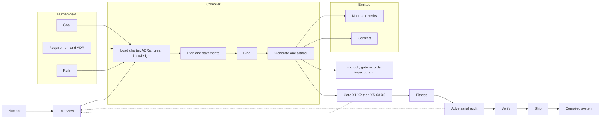

# NLC components

Reference map of Natural Language Coding at the same grain as the Zygotic workflow diagram (`richardpickett/webs/doc/diagrams/zygotic-workflow.json`).

React Flow seed (same document shape as that workflow): [`nlc-components.json`](nlc-components.json).

Sources: [`ARCHITECTURE.md`](../nlc/compiler/ARCHITECTURE.md), [`PROCESS.md`](../nlc/compiler/PROCESS.md), [`BOUNDARY.md`](../../integrity/BOUNDARY.md).

## Same grain as the workflow diagram

| Zygotic workflow node | NLC component | What it holds |
| --- | --- | --- |
| User | Human | Goals, requirements, ADRs, RCA sign-off, `Released-by:` |
| Interaction | Interview | Names outcomes and constraints. No codegen. Skill: `interview` |
| Integration | `./nlc` + harness | Human: `verify`, `verify-deep`, `ship-check`, `new`, `doctor`. Agent: `/interview`, `/planit`, `/verify` |
| Work Unit | Goal | One outcome. Calls verbs. Does not write noun fields |
| Tasks | Product statements / atomic actions | One boundary per statement. Each action has `id` and `plan_step_id` |
| Orchestration | PLANIT | Load, interview, plan, bind, generate, verify. Skill: `planit` |
| Metaprompts | Skills | `planit`, `interview`, `verify`, `bbp-proposer`, `bbp-reviewer`, `bbp-confirmer`, `bbp-recorder`, `release` |
| Agent Workers | Leaf skills | Propose, review, confirm, record. One artifact per emit |
| Agents | Agent nouns | Standards steward, knowledge steward, quality architect, adversarial auditor, ship role |
| File / Artifact Store | Emit | One artifact plus `emit-manifest.json` |
| Operational Data | `.nlc/` | Lock file, rule-IR snapshot, gate records, impact graph, delta-regen queue |
| Quality System | Gates | G1–G4, handoffs, pipeline wire X1 X2 X5 X3 X6, `./nlc verify` |
| Audit | Adversarial audit | Findings only. No ship authority. Includes incomplete-packet hunt |
| Dashboard | Quality metric | Ops / opportunities. Binary PASS/FAIL. No UI dashboard in the hub |
| Completed Work | Compiled system | BBP-shaped app tree after verify. Ship is a later human-signed step |
| Zygote (group) | Compiler | Intent in, one gated artifact out, or refuse |

## Citizens

**Humans hold:** Goal, Requirement, ADR, Interview, RCA. Rules (ADR 0007) and the charter sit with these. Knowledge-domain facts are loaded, not a separate citizen type.

**Compiler emits:** Noun (identity, private state, adjectives), Verb (only legal mutation), Goal-as-boundary, Contract, Gate. A goal is on both lists: the outcome asked for, and a boundary that may only call published verbs.

## Pipeline seats

From [`BOUNDARY.md`](../../integrity/BOUNDARY.md), in order:

1. Plan — Plan Steward. Exit handoff is not refuse-wired yet.
2. Produce — Producer. Package plus SSOT exit evidence.
3. Fitness — Quality Architect. `MET` / `FAIL` / `handoff_refused`.
4. Adversarial Audit — Adversarial Auditor.
5. UAT / Promote Evidence — Release Conductor. Soft-green into Ship refuses.
6. Ship — Ship Role. Needs a mandate and UAT greenlight.
7. Execute-Release — Release Conductor.
8. Instance Heal — Release Conductor, Defect Remediator.

Side path: Conduct-RCA, Raise-Readiness (P-030), HITL Root-Approve, then back to Produce. System change inserts System-Remediate Design before Produce.

**Enforcement nouns:** Boundary, Handoff, Action (atomic or compound), Binding matrix (requirement, audit, gate), Quality metric.

Produce, Audit, and Ship are different roles. Audit does not authorize release. Verify (`./nlc verify` / `verify-deep`) is compile. Ship (`./nlc ship-check` after `Released-by:`) is release.

## Diagram

A gate or audit failure returns to Interview or Bind, then Generate again. The next statement does not start on FAIL.
